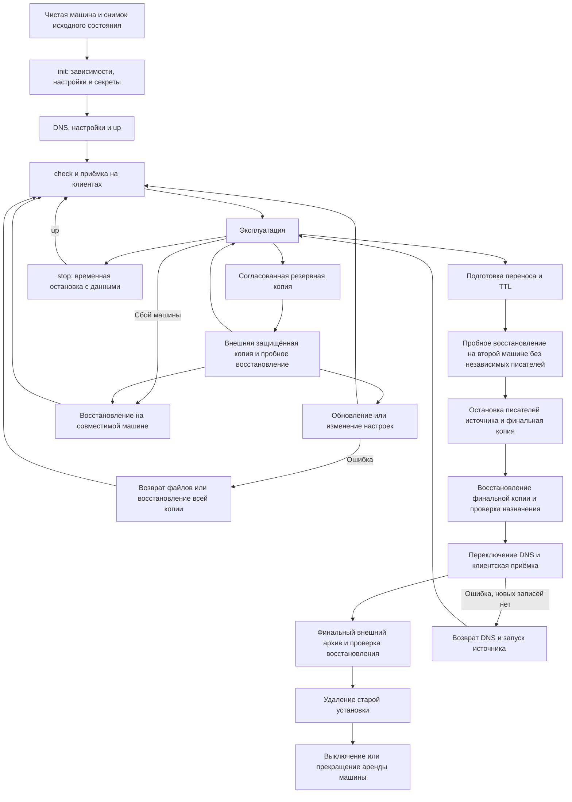

# Жизненный цикл установки

Это справочник переходов между установкой, эксплуатацией, восстановлением
и удалением. Для пошагового восстановления используйте [backup.md](backup.md),
для обновления — [README](README.md#10-обновление). Команды выполняются в SSH-сессии
администратора сервера; `/opt/matrix-stack` заменяют выбранным каталогом установки.

Ниже описана основная установка с локальным MAS. При внешнем MAS копия Misbot
содержит Synapse и локальные файлы; состояние внешнего MAS сохраняют отдельно.
Условия активации — в [копиях при внешнем MAS](backup.md#копии-при-внешнем-mas).

## Переходы и восстановление

| Переход | Условия начала | Действие | Успех | Ошибка и продолжение |
|---|---|---|---|---|
| Чистая машина → init | Согласованы IP и окончательный домен; снят исходный снимок; выделенный каталог пуст | Из распакованного комплекта: `sudo python3 misbot.py config init --domain example.org` | Закрытые env/секреты и исходники, системная команда; сообщение `Initialized`; повтор не меняет ключи | Исправить ввод/доступ к apt; повторить init с теми же доменом и каталогом; не удалять уже созданные секреты |
| init → up | Семь A, нет AAAA; открыты нужные порты; заполнен env; внешние ресурсы готовы | `sudo misbot start` | `installation_running`, завершение 0 | Исправить причину по сообщению; повторить start; при пропавших ключах восстановить полный комплект |
| up → приёмка | Контейнеры работают | `status`, `check`; вход, история, вложение, федерация и звонок с реальных устройств | Автоматические проверки и отдельный журнал клиентской приёмки | HTTP 200 не доказывает вход/звонок; оставить соответствующую проверку открытой |
| Приёмка → эксплуатация | Успешная приёмка; внешняя копия; определены ответственный и расписание | Контроль места, состояния, срока сертификатов; регулярный backup | Проверяемая свежая копия, достаточно диска, службы готовы | Предотвратить заполнение диска; сохранять исходную копию при неудачной новой |
| Эксплуатация → backup | PostgreSQL доступен; место для дампов, вложенного и итогового архивов | `sudo misbot backup create`, `sudo misbot backup verify`, защищённый экспорт | Писатели возвращены в прежнее состояние; дампы восстановлены во временные БД; экспорт проверен | Проверить `status` после любой ошибки/прерывания; при незавершённой остановке выполнить `sudo misbot backup recover`; не считать неполный архив копией |
| Копия → обновление | Копия проверена; изучена совместимость и схема БД | `sudo misbot update check`, затем `sudo misbot update latest`; альтернатива — `sudo python3 misbot.py update --directory /opt/matrix-stack` из нового проверенного комплекта | Версия/revision совпадают, start/check и клиентская проверка проходят | Снимок файлов не откатывает изменения БД; при миграции схемы восстановить согласованную предшествующую копию на совместимых образах |
| Копия → изменение настроек | Понятно, какие службы изменятся; резервная копия есть | Изменить поддерживаемые настройки через UI либо приватный env; `sudo misbot config generate`, затем `sudo misbot start` | Сохранились домен, идентичность, ключи, данные; новое поведение проверено | Вернуть сохранённый env/конфигурацию и повторить start; storage mode, server_name и OAuth issuer нельзя менять как обычную настройку |
| Эксплуатация → stop | Пользователи предупреждены о недоступности | `sudo misbot stop` | Все контейнеры остановлены, данные остались | Проверить `status`; устранить ошибку Docker; повтор безопасен при сохранённых данных |
| stop → запуск | Ключи и данные целы; DNS по-прежнему верен | `sudo misbot start`, затем `sudo misbot check` | Установка и клиентские операции восстановлены | Не создавать новые ключи поверх сохранённых БД |
| Сбой → восстановление | Есть доверенная копия и совместимые образы; назначение пустое либо принадлежит той же незавершённой операции | Выполнить staged-восстановление по [backup.md](backup.md); сохранить server_name | Сверены пользователи, комнаты, медиа, авторизация, ключи и бот | Устранить причину и повторить исходную restore-команду с теми же архивом, SHA, IP и каталогом; ручной повторный импорт в частично заполненную БД не допускается |
| Эксплуатация → подготовка переноса | Подтверждена вторая машина; управление DNS; источник остаётся доступен | Снизить TTL заранее, записать старые A/AAAA; копия и изолированное восстановление | Назначение прошло проверки до DNS без независимой записи | Исправить совместимость/место; продолжать работу на источнике |
| Подготовка → финальная синхронизация | Пробное восстановление принято; начало окна остановки | Остановить всех писателей источника; сделать и экспортировать финальную согласованную копию; источник оставить остановленным | Обе БД, медиа, ключи и состояние бота соответствуют одному окну без записей | Обычный backup возобновляет писателей; для финального переноса это недопустимо. Проверить, что они оставались остановленными |
| Финальная копия → назначение | Источник не пишет; место и контрольные суммы проверены; финальный каталог пуст | Восстановить финальный архив в новый пустой каталог, проверить staged-результат; активировать после DNS | Идентичность и контрольные данные совпадают | Другой архив не принимается поверх staged-пробы. Повторять только исходную restore-команду с тем же SHA/IP/режимом БД; источник остаётся остановленным |
| Назначение → DNS | Назначение готово принимать трафик; единственный писатель | Переключить семь A; убрать или корректно переключить AAAA согласно архитектуре; проверить авторитетный DNS и кэши | Публичный HTTPS, OAuth, история, медиа, федерация и звонки проверены | При сохранённых кэшах ждать TTL и проверять старый маршрут; не включать независимый старый стек |
| DNS → приёмка переноса | Пользователи достигают назначения | Проверки с устройств и внешней сети; записать длительность перерыва | Нет пропавших данных/ключей/привязок, старые вложения читаются | После новых записей простой возврат DNS теряет данные: сначала остановить назначение и выполнить обратное согласованное восстановление |
| Приёмка → вывод источника | Принята новая установка; полная финальная копия экспортирована и пробно восстановлена | Сохранить архив, манифест, версии, инструкции, снимок внешних ресурсов; отдельное удаление старого стека | Восстановимость проверена; удалены только утверждённые ресурсы | Если нет внешней копии или приёмки, удаление запрещено; источник сохранять остановленным |
| Удаление → выключение | Нет оставшихся служб/данных, которые нужны владельцу | Отключить машину или завершить аренду через провайдера | Финальный архив доступен независимо от выключенной машины | Решение принимает владелец; выключение не заменяет удаление секретов и завершение аренды |

## Применение конфигурации

Изменённые файлы конфигурации применяются при `start` и штатном обновлении:
Misbot сравнивает их содержимое через отметки отдельных служб в Compose.
Пересоздаются потребители изменённых файлов, включая общую RTC-регистрацию
Synapse/JWT и адаптер S3, даже если версии образов прежние. Повтор с теми же
байтами конфигурации не вызывает пересоздание из-за этих отметок. После создания
аккаунтов ботов отметки обновляются перед запуском ботов. Базы, очереди,
криптографические хранилища и обновление TLS-сертификатов в сравнение не входят.
При восстановлении прежних настроек отметки вычисляются заново из их содержимого.

## Остановка, удаление и выключение

`stop` сохраняет установку. Контейнеры с `restart: unless-stopped` обычно не
перезапускаются после явной остановки. Проверяйте результат после перезагрузки.
Таймер обновления TURN-сертификата остаётся установленным: состояние systemd
тоже входит в проверку временной остановки.

`install.sh down` удаляет контейнеры и сеть установки, оставляя данные и ключи.
Он освобождает Compose slot, но не удаляет сам сервер. Возврат через `start`
возможен при сохранённых данных и отсутствии незавершённых операций.

Полное удаление установки — отдельная операция: контейнеры/сети, каталог данных,
сертификатные units, sysctl и созданный swap. Docker может принадлежать другим
проектам: удалять его и общие образы можно только по инвентаризации. Выключение
машины оставляет данные на диске. Внешние БД/S3/Vault/копии имеют отдельный срок
хранения и не удаляются командой Compose.

Для полигона сравнивают состояние до и после: пакеты, units, файлы, firewall,
sysctl, swap, сети и порты. Изменения DNS также учитываются; SSH сохраняют.
Порядок удаления и точные пути утверждают по исходному снимку, а не по этой
общей схеме.

## Перерыв и единственный писатель

В управляемой установке один Synapse, локальный либо внешний MAS и сохранённое
состояние ботов. При переносе нужно окно остановки записи: финальный дамп
Synapse и локального MAS, упаковка медиа/ключей, передача, импорт и проверка
назначения. Время зависит от объёма и конфигурации;
его оценивают пробным восстановлением. Предварительное копирование медиа
уменьшает объём финальной передачи,
но само по себе не обеспечивает согласованность.

Нулевой простой этой процедуры не подтверждён и не обеспечивается переключением
DNS: кэшированные клиенты могут обращаться к старому адресу. Для отдельного
проекта без простоя нужны единая БД/репликация с управляемым переключением,
единое хранилище медиа, согласованная авторизация/бот и старый маршрут, ведущий
к единственному новому писателю. Два независимых восстановления одной копии
нельзя запускать как две рабочие установки.

## Ограничения отката и пользовательские ключи

Обычное обновление portable и existing-compose проверяет версию установленного
комплекта и схему данных до резервного копирования и публикации файлов. Понижение
версии или схемы, включая комплект без объявления уже используемой схемы,
отклоняется. Для отката используйте процедуру восстановления из проверенной копии.

`update latest` выбирает последний стабильный релиз, затем проверяет допуск
к применению. При несовместимости он остановится; более ранний совместимый
кандидат автоматически не подбирается.

Вернуть исходники можно лишь при совместимой конфигурации и данных. Synapse
может менять схему; ограничения описаны в [официальной инструкции обновления](https://element-hq.github.io/synapse/latest/upgrade.html).
Логические дампы требуют ролей и совместимого сервера:
[PostgreSQL SQL dump](https://www.postgresql.org/docs/current/backup-dump.html).
После восстановления прежней копии новые записи за последующее время будут
отсутствовать; это надо учитывать в плане возврата.

Серверная копия включает зашифрованные события, но не все личные ключи устройств
пользователей. Для чтения E2EE-истории нужен сохранённый доверенный клиент,
экспорт ключей или рабочее клиентское восстановление ключей. Вход OAuth не
заменяет его. Сессия/crypto store бота и обе серверные БД восстанавливаются вместе.

## Удаление сервера с сохранением утилиты

`sudo misbot remove` — многоэтапный выбор локальных данных, секретов, копий,
S3-префиксов со всеми версиями, принадлежащих установке внешних БД и Vault,
затем финальное подтверждение доменом. Поддерживается после init и незавершённой установки.
Утилита остаётся; [описание](README.md#11-панель-приветствия-и-полное-удаление).
`install.sh down` продолжает освобождать Compose slot с сохранением данных.

Удалённые данные и версии внешних объектов нельзя вернуть отменой команды.
Перед подтверждением доменом проверьте выбранные ресурсы и независимую копию,
а после операции — итоговый список удаления. Внешний MAS этой операцией
не удаляется; он имеет отдельного владельца и процедуру хранения данных.
