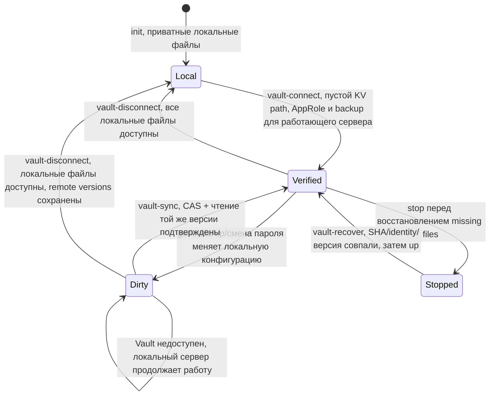

# Vault: секретные файлы, локальный кэш и восстановление доступа

## Что делает интеграция

Установщик сохраняет версионные снимки
секретных файлов в **Vault KV v2** через **AppRole**. Файлы остаются на VPS
с прежними владельцами/правами: сервисы читают локальный кэш. Vault недоступен —
сервер продолжает запуск с сохранёнными локальными файлами, а установщик
показывает `vault_snapshot passed=false` и команду повторной синхронизации.
Снимок помечается stale до подтверждённого чтения новой версии.

Это выбранная интеграция статических секретов. Дополнительный Vault Agent и
динамические пароли БД/leases не используются. Snapshot включает `secrets/*`,
settings.env, ключ и defaults MAS, сессию бота, его cross-signing файл,
ключ подписи Synapse и checkpoint внешней PostgreSQL, когда они существуют.
Размер исходных файлов ограничен 512 KiB. Тело передаётся по проверенному HTTPS,
секреты не попадают в argv, output или diagnostic messages. AppRole token
используется только в памяти. Произвольные секретные каталоги не экспортируются.

**Vault не заменяет полный server backup:** в снимке нет обеих серверных БД,
медиа и всех состояний бота. Потерянную машину восстанавливают по [backup.md](backup.md).
Клиентские E2EE recovery keys сохраняются отдельно. Ключ расшифрования внешнего
архива храните независимо от этой машины и Vault, иначе отказ Vault лишит копии.

Проверяйте подключение, повтор, отказ сервиса, локальный cache, восстановление файлов и смену AppRole для своей конфигурации. Полное восстановление сервера и клиентских E2EE ключей требуют отдельных проверок.

## Архитектура и переходы



Recover при dirty запрещён: старый пароль/ключ нельзя автоматически подставлять
вместо нового. Переезд не меняет `server_name` или snapshot owner. При успешном
восстановлении полного архива snapshot синхронизируется после запуска; отдельные
AppRole-файлы за пределами установки нужно безопасно доставить на новую машину.
Писатели старой машины должны быть остановлены до запуска новой.

## Подготовка владельцем Vault

Нужны доступный HTTPS Vault с доверенным сертификатом, KV v2 mount и пустой
выделенный путь. Администратор Vault создаёт AppRole со следующей политикой,
заменяя mount/path своими. Установщику не передают root token или unseal keys.

```hcl
path "matrix/data/installer/example" {
  capabilities = ["create", "update", "read"]
}
```

Другие пути, list/delete/admin capabilities не нужны. Установите короткий TTL
выданного token и срок/порядок обновления SecretID согласно вашей эксплуатации;
истечение SecretID не удаляет локальный кэш. Используются стандартные
[AppRole HTTP API](https://developer.hashicorp.com/vault/api-docs/auth/approle)
и [KV v2 HTTP API](https://developer.hashicorp.com/vault/api-docs/secret/kv/kv-v2).
CAS исключает перезапись версии, изменённой независимо от установщика.

RoleID и SecretID доставьте отдельными приватными файлами по SSH. Создайте env
на **VPS**, например в `/root/vault-connection.env`:

```bash
sudo touch /root/vault-connection.env
sudo chmod 600 /root/vault-connection.env
sudo nano /root/vault-connection.env
```

```dotenv
VAULT_ADDR=https://vault.example.org
VAULT_KV_MOUNT=matrix
VAULT_SECRET_PATH=installer/example
VAULT_ROLE_ID_FILE=/root/vault-role-id
VAULT_SECRET_ID_FILE=/root/vault-secret-id
VAULT_CA_FILE=
```

CA_FILE пуст для сертификата от общедоверенного CA; для частного CA укажите
PEM на VPS. Не отключайте проверку TLS. Три файла env/RoleID/SecretID — обычные
файлы владельца root mode 600, без symlinks. Не выполняйте `source` и не
передавайте значения в историю команд. В env находятся пути, не credentials.

## Подключение до первого запуска или позднее

После `init`, когда установлены исходники, на VPS:

```bash
sudo bash /opt/matrix-stack/install.sh vault-connect /root/vault-connection.env
sudo bash /opt/matrix-stack/install.sh up
sudo bash /opt/matrix-stack/install.sh vault-sync
sudo bash /opt/matrix-stack/install.sh check
```

Ожидается `vault_snapshot passed=true`, число файлов и version без содержимого.
`up` добавляет созданные Synapse/MAS/bot файлы в снимок; `vault-sync` можно
Повторять позднее. Повтор неизменённого снимка не создаёт новую версию.
Для работающего сервера `vault-connect` сначала создаёт полный backup и
восстанавливает временные БД для проверки; окно остановки как у `backup`.
Сам экспорт файлов и `vault-sync` сервер не останавливают.

Чужой/занятый path отклоняется; чужие версии не удаляются. При потере ответа
после записи повтор сверяет owner и точный payload, принимает уже сохранённую
версию. Не удаляйте приватный `config/vault-state.json` ради повторного подключения.
Другой endpoint/mount/path через повторный connect менять нельзя.

## Смена AppRole и восстановление доступа

Администратор Vault выдаёт новый SecretID или отдельный AppRole с политикой на
тот же path. Сохраните его в **новом** закрытом файле, оставляя прежний доступ
до проверки. Создайте новый env с теми же address/mount/path, новыми auth paths.

```bash
sudo bash /opt/matrix-stack/install.sh vault-auth /root/vault-connection-new.env
sudo bash /opt/matrix-stack/install.sh vault-sync
sudo bash /opt/matrix-stack/install.sh check
```

Ожидается snapshot passed=true. При отказе auth/policy старый connection.env
сохраняется или восстанавливается. Только после успеха администратор Vault
отзывает старый SecretID/AppRole. Сам установщик не имеет прав отзывать AppRole.
Если старый SecretID уже отозван, Matrix работает с локальными файлами; новый
`vault-auth` восстанавливает синхронизацию без сброса серверных credentials.

## Восстановление отсутствующих секретных файлов

Только для подтверждённой snapshot версии, когда descriptor/connection и
каталоги сохранились. Не применяется к потере всей машины/БД или dirty snapshot.

```bash
sudo bash /opt/matrix-stack/install.sh stop
sudo bash /opt/matrix-stack/install.sh vault-recover
sudo bash /opt/matrix-stack/install.sh up
sudo bash /opt/matrix-stack/install.sh check
```

Ожидается `vault_recovered passed=true` с количеством **недостающих** файлов,
затем успешный check. До записи проверяются owner/domain/version, полный
inventory, размеры и SHA каждого файла. Существующий отличающийся файл не
заменяется: это может быть новый пароль или ключ. Частичный recover после
прерывания повторяется; уже восстановленные совпадающие файлы остаются.
При mismatch/stale используйте полный проверенный backup и процедуру восстановления.
Не удаляйте действующие файлы для искусственного согласования со старой версией.

## Продолжить без Vault

При `restore-local` старый `config/external-postgres-owner.json` удаляется
намеренно: новая локальная БД не должна подключаться к исходному кластеру.
`vault-disconnect` учитывает только это исключение у ready staged
local-postgres target с остановленными non-Postgres службами. Отсутствие
другого файла из архивного inventory требует восстановления до отключения;
не возвращайте внешний connector ради обхода сообщения. Повторите исходную
restore-local команду тем же
архивом из нового доверенного совместимого комплекта, затем vault-disconnect.

При доступном полном локальном кэше, включая все перечисленные snapshot файлы:

```bash
sudo bash /opt/matrix-stack/install.sh vault-disconnect
sudo bash /opt/matrix-stack/install.sh up
sudo bash /opt/matrix-stack/install.sh check
```

Vault может быть недоступен. Локальные credentials не меняются, remote versions
сохраняются; descriptor и connection удаляются из текущей установки. Для нового
подключения выберите новый пустой path. Удаление remote versions/retention —
операция администратора Vault после проверки внешней полной копии.

`vault-disconnect` также разрешён у `ready` staged restore target,
когда все службы, кроме PostgreSQL, остановлены. Выполните до первой активации,
если эта копия должна работать без Vault либо исходный Vault path ещё используется
другой машиной. Команда не обращается к Vault и сохраняет локальные credentials.
Повтор после прерывания завершает удаление connector; повтор завершённой операции
сообщает `changed=false`. Для importing target либо работающих staged служб
следуйте отказу: повторите исходный restore/restore-local до ready либо остановите
target через `install.sh stop`, затем повторите disconnect. Sync/connect/auth/
recover до завершения восстановления запрещены.

## Ошибки и вопросы

| Событие | Что означает / безопасный путь |
|---|---|
| Env 644 или symlink | Закройте обычный файл mode 600, повторите ту же команду |
| Неверный SecretID, policy, запечатанный Vault, TLS или DNS | Выход ненулевой; значения не выводятся. Исправьте ресурс/auth, повторите connect/sync/auth; локальные данные сохраняются |
| Нет ответа | HTTP timeout 15 s для каждого запроса; операция не считается принятой до readback. Сохраните descriptor и повторите |
| Dirty после generate/смены пароля | Новый локальный секрет ещё не подтверждён снаружи; sync или полная encrypted copy; recover старой версии запрещён |
| Другая операция установщика | Дождитесь её завершения, status и повтор; не удаляйте lock |
| Недостаток памяти / большой snapshot | До 512 KiB source bytes; Vault хранит статические файлы, данные переносите полным backup |
| Перенос на новый VPS | Нужны полный archive, независимый backup key и отдельная доставка AppRole-файлов; Vault snapshot не является серверным restore |

Новичку нужны точные пути файлов и отдельный success/readback, администратору —
ограниченная политика и ротация AppRole, возвращающемуся после сбоя — descriptor,
локальный кэш, full backup и различие dirty/verified. Перед финальным выключением
машины проверяют полный внешний архив, не только сообщение vault_snapshot.
